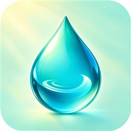

# Siprise

  

<strong>A gentle, private water tracker for Android.</strong> 
Log a sip, see your progress, and keep a simple daily rhythm. Your intake history stays on your device.

## What it does

- Log 150 ml, 250 ml, 500 ml, or a custom amount.
- Undo the most recent entry.
- Set a daily goal and review the last seven days.
- Turn on daytime reminders and choose an interval.
- Works offline; no account or internet permission.

## Build

- Android Studio with Android SDK 37
- JDK 17
- Android 13 (API 33) or newer

Open the project in Android Studio or run `gradlew.bat assembleDebug` on Windows (`./gradlew assembleDebug` on macOS/Linux). The debug APK is written to `app/build/outputs/apk/debug/app-debug.apk`.

## Releases and Droidify

The source is `1.0.0` (`versionCode` 1). Pushing the matching `v1.0.0` tag builds and verifies a signed APK, publishes a [GitHub release](https://github.com/saurabhkundu1/siprise-android/releases), and sends it to [Applify](https://saurabhkundu1.github.io/Applify/) for the Droidify-compatible repository.

Before the first release, configure a new Siprise app-signing key and the Applify repository's replacement signing fingerprint. The workflow requires repository secrets `ANDROID_KEYSTORE_BASE64`, `ANDROID_KEYSTORE_PASSWORD`, `ANDROID_KEY_ALIAS`, `ANDROID_KEY_PASSWORD`, and `APPLIFY_DISPATCH_TOKEN`; variables `APPLIFY_RELEASES_ENABLED`, `EXPECTED_WATERTRACKER_SIGNER_SHA256`, and `EXPECTED_REPO_SIGNER_SHA256`; and the matching `EXPECTED_WATERTRACKER_SIGNER_SHA256` variable in Applify. The dispatch token needs Contents: write access to Applify.

## Privacy

Siprise stores intake history and preferences locally. Reminders are off until enabled and require notification permission on Android 13 and newer. The default daily goal is 2,000 ml. Siprise is a personal logging tool, not medical advice.

## License

Apache License 2.0. See [LICENSE](LICENSE).
