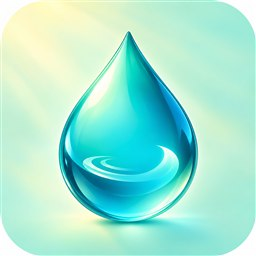

# Siprise 💧

[](LICENSE)
[-green.svg)](https://developer.android.com)
[](https://developer.android.com)
[](https://developer.android.com)
[](https://developer.android.com/jetpack/compose)
[](https://saurabhkundu1.github.io/Applify/)

<p align="center">
  
</p>

<p align="center">
  <strong>A gentle, accessible, offline hydration companion for Android.</strong><br>
  Log a sip, track daily progress with responsive animated rings, view 7-day intake trends, and quick-log directly from your home screen widget.
</p>

---

## 🌊 Overview

**Siprise** is crafted to make daily hydration mindful, effortless, and private:
- **Zero Distractions & Pure Offline:** No accounts, no subscriptions, no ads, and zero internet permission. Your intake history never leaves your device.
- **Accessible Design:** Full TalkBack screen reader support with live semantic announcements for progress rings, intake totals, and buttons.
- **Home-Screen Glanceability:** Home-screen widget displaying real-time daily progress with a one-tap quick-log button.
- **Intelligent Daytime Reminders:** Gentle notifications that automatically pause when your daily goal is reached and resume the next morning.

---

## ✨ Features

### 1. Intuitive Hydration Logging
- Quick-log chips for standard drink sizes: **150 ml**, **250 ml**, and **500 ml**.
- Custom volume intake selector allowing any amount between 50 ml and 1,000 ml in 50 ml increments.
- Immediate **Undo** action for accidental taps.
- Dynamic 12-hour or 24-hour timestamp formatting matching device locale.

### 2. Animated Progress Ring & TalkBack Accessibility
- Smooth animated circular progress ring visualizing daily hydration vs target goal.
- Built-in Android accessibility semantics: screen readers announce exact percentages, current total, and remaining volume (e.g., *"Hydration progress: 75 percent, 1500 milliliters logged of 2000 milliliter goal"*).

### 3. Home-Screen AppWidget (`SipriseWidget.kt`)
- Interactive home-screen widget keeping today's hydration front and center.
- Configurable one-tap quick-log button (customizable in-app from 50 to 1,000 ml; default: 250 ml).
- Displays today's total volume and goal percentage with full screen reader accessibility descriptions.

### 4. 7-Day History & Weekly Trends
- Clean weekly bar chart breaking down daily hydration over the rolling seven days.
- Visual goal markers highlighting days where the daily target was achieved.

### 5. Smart Daytime Reminder Scheduling
- Set custom reminder intervals (e.g., every 60 or 90 minutes) within active waking hours (supports daytime and overnight shift schedules).
- Automatic goal pause: notifications gracefully pause once the daily target is reached.
- Actionable notification snooze: snooze a nudge for 30 minutes directly from the notification tray.

### 6. Absolute Privacy
- Zero network permissions (`android.permission.INTERNET` is not included in the manifest).
- All logs and preferences are stored in app-private on-device storage.

---

## 🛠️ Architecture & Tech Stack

```
Siprise/
├── app/
│   ├── src/main/java/com/applify/watertracker/
│   │   ├── MainActivity.kt        # Jetpack Compose UI, state management, and navigation
│   │   └── SipriseWidget.kt       # Home-screen AppWidget provider and quick-log action
│   ├── src/test/java/com/applify/watertracker/
│   │   └── ReminderSchedulerTest.kt # Reminder window calculation & rollover test suite
│   ├── src/main/res/
│   │   ├── drawable-nodpi/ic_siprise.jpg
│   │   └── mipmap-*/
│   └── build.gradle.kts           # Module build configuration (SDK 35)
├── LICENSE                        # MIT License
└── README.md
```

### Key Technologies
- **Language:** Kotlin 2.x
- **Target SDK:** 35 (Android 15)
- **Compile SDK:** 35
- **Minimum SDK:** 33 (Android 13 Tiramisu)
- **UI:** Jetpack Compose with Material Design 3
- **Widgets:** Android AppWidget Framework
- **Testing:** JUnit 4 unit testing for reminder scheduling logic
- **Quality Gates:** `warningsAsErrors = true` enforced

---

## 🚀 Building & Testing

### Prerequisites
- **JDK:** 17 or higher
- **Android SDK:** API 35 with Build Tools installed

### Command-Line Build

```powershell
# Assemble debug APK
.\gradlew.bat assembleDebug

# Run unit tests
.\gradlew.bat testDebugUnitTest

# Run strict Android lint checks
.\gradlew.bat lintDebug
```

On Linux or macOS:
```bash
./gradlew assembleDebug
./gradlew testDebugUnitTest
./gradlew lintDebug
```

The compiled APK will be generated at:
`app/build/outputs/apk/debug/app-debug.apk`

---

## 📦 Distribution & Releases

- **Applify Portal:** Hosted on [Applify](https://saurabhkundu1.github.io/Applify/) (`com.applify.watertracker`).
- **Droidify / F-Droid:** Add the Applify repository to your F-Droid client:
  ```
  https://saurabhkundu1.github.io/Applify/fdroid/repo
  ```
- **GitHub Releases:** Tagged releases (`vMAJOR.MINOR.PATCH`) automatically trigger the release pipeline to sign the APK, create GitHub releases, and update the Applify distribution repository.

---

## 📄 License

Siprise is open source software released under the **[MIT License](LICENSE)**.

```
Copyright (c) 2026 Saurabh Kundu

Permission is hereby granted, free of charge, to any person obtaining a copy
of this software and associated documentation files (the "Software"), to deal
in the Software without restriction...
```

See [LICENSE](LICENSE) for the full license text.
